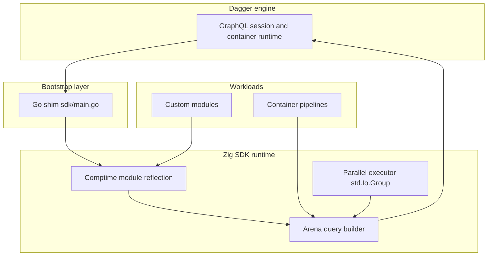
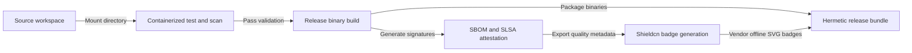

<p align="center">
  <picture>
    <source media="(prefers-color-scheme: dark)" srcset="https://shieldcn.dev/header/graph.svg?title=dagger-zig&subtitle=Native+Zig+SDK+for+the+Dagger+Engine&logo=zig&theme=zinc&mode=dark" />
    
  </picture>
</p>

<p align="center">
  <a href="https://github.com/MChorfa/dagger-zig/releases"></a>
  <a href="https://github.com/MChorfa/dagger-zig/actions/workflows/ci.yml"></a>
  <a href="https://github.com/MChorfa/dagger-zig/stargazers"></a>
  <a href="https://github.com/MChorfa/dagger-zig/network/members"></a>
  <a href="https://github.com/MChorfa/dagger-zig/blob/main/LICENSE"></a>
  <a href="https://github.com/MChorfa/dagger-zig/commits/main"></a>
</p>

<p align="center">
  
  
  
  
  
  
  
  
</p>

A native Zig SDK for the [Dagger](https://dagger.io) engine. The code depends only on the Zig standard library and targets Zig 0.16 and 0.17.

The current release is v0.3.5. It provides a synchronous client for Linux and macOS, concurrent pipelines using `std.Io.Group` and `Client.branch`, module authoring, and tracing. Windows support is planned.

The project is self-hosting. The CI pipeline in [`ci/`](ci/) is a Dagger module written in Zig with this SDK.

Tagged releases publish CycloneDX and SPDX SBOMs, Sigstore signatures, and SLSA Build Level 3 provenance. See [docs/compliance.md](docs/compliance.md).

## Supported features

* Client API on Linux and macOS for containers, directories, files, secrets, cache volumes, services, and git operations.
* Module authoring with Zig structs. Expose structs with `dagger.module.serve`. Comptime reflection maps Zig types to Dagger `TypeDef` definitions, rejecting invalid signatures at compile time instead of runtime dispatch.
* Parallel pipeline execution using `dagger.parallel` map and forEach helpers over `std.Io.Group`. Each task receives an isolated `Client.branch`. See [examples/parallel](examples/parallel/main.zig).
* OpenTelemetry compatible spans via `dagger.tracing`.
* CLI session handshake resolving the active binary from the `dagger run` environment, `_EXPERIMENTAL_DAGGER_CLI_BIN`, or system path, without background downloads.
* SPIFFE and SPIRE workload identity under `-Dspiffe-experimental`, using the `spire-agent` backend. See [docs/spiffe.md](docs/spiffe.md).
* Self-hosting pipeline where building, testing, linting, and releases run as a native Zig Dagger module.

## Planned work

Windows support, the C ABI via `zig build c-lib`, the native SPIFFE Workload API, and per-module code generation remain under active development. See [docs/roadmap.md](docs/roadmap.md).

## Quick start

```zig
const std = @import("std");
const dagger = @import("dagger_sdk");

pub fn main() !void {
    var gpa_state: std.heap.GeneralPurposeAllocator(.{}) = .{};
    defer _ = gpa_state.deinit();
    const gpa = gpa_state.allocator();

    var io_impl: std.Io.Threaded = .init(gpa, .{});
    defer io_impl.deinit();
    const io = io_impl.io();

    var client = try dagger.connect(gpa, io, .{});
    defer client.close();

    // Builder calls return !T. Handles evaluate lazily when reading terminal output.
    const ctr = try client.dag().container(null);
    const alpine = try ctr.from("alpine:latest", null);
    const exec = try alpine.withExec(&.{ "echo", "hello from zig" }, null, null, null, null, null, null, null, null, null, null);
    const out = try exec.stdout();
    defer gpa.free(out);
    std.debug.print("{s}", .{out});
}
```

```bash
dagger run -- zig build run-first-pipeline
```

## Module authoring

```zig
const std = @import("std");
const dagger = @import("dagger_sdk");

const MyModule = struct {
    pub fn build(
        self: *const MyModule,
        ctx: *dagger.module.Context,
        source: dagger.Directory,
    ) !dagger.Container {
        _ = self;
        const ctr = try ctx.container();
        const based = try ctr.from("golang:1.23-alpine", null);
        const sourced = try based.withDirectory("/src", (try source.id()).value, null, null, null, null, null, null);
        const workdir = try sourced.withWorkdir("/src", null);
        return workdir.withExec(&.{ "go", "build", "./..." }, null, null, null, null, null, null, null, null, null, null);
    }
};

pub fn main(init: std.process.Init) !void {
    return dagger.module.serve(init, MyModule{});
}
```

```json
{
  "name": "my-pipeline",
  "sdk": "github.com/MChorfa/dagger-zig/sdk@v0.3.4",
  "source": "."
}
```

```bash
dagger develop
dagger call build --source=.
```

Additional examples include [parallel pipelines](examples/parallel/main.zig) using `Io.Group`, [C and Python FFI](examples/c-client/), [SPIFFE registry authentication](docs/spiffe.md), and the [end-to-end module](examples/e2e-module/).

## Release verification

Tagged releases include cryptographic signatures and SLSA Build Level 3 provenance:

```bash
scripts/release-verify.sh v0.3.4
```

Detailed verification steps using `slsa-verifier`, `gh attestation verify`, and `cosign verify-blob` are documented in [docs/compliance.md](docs/compliance.md).

## Build targets

```shell
zig build                          Build the library module
zig build -Dspiffe-experimental    Enable experimental SPIFFE support
zig build test                     Run offline unit tests
zig build test-module              Verify module runtime comptime types
zig build test-suite               Run complete test suite across platforms
zig build test-integration         Run integration tests against live engine
zig build bench                    Run offline query and serialization benchmarks
zig build flamegraph               Generate CPU flamegraph SVG
zig build codegen                  Regenerate bindings from engine schema
zig build run-first-pipeline       Run first container pipeline example
zig build run-parallel             Run concurrent pipeline example
```

## Repository layout

```shell
src/        Query builder, core types, tracing, parallel engine, module runtime, SPIFFE
ci/         Self-hosting CI pipeline implemented as a Zig Dagger module
sdk/        Bootstrap layer for engine communication
codegen/    Introspection bindings generator
examples/   Runnable pipeline examples
tests/      Integration tests and offline unit tests
docs/       Technical guides and specifications
scripts/    Release verification and testing scripts
```

## Architecture decisions



* Standard library only. The SDK avoids third-party Zig packages and uses standard library HTTP, JSON, TLS, sockets, and subprocess facilities. This simplifies air-gapped deployments.
* Arena allocation for query chains. Handles allocate within the client arena and release when calling `client.close`. This eliminates reference counting overhead.
* Constant module receivers. Module functions accept `self: *const Self`. Disallowing state mutation during dispatch guarantees safe parallel invocation across concurrent engine requests.
* Go bootstrap shim. The `sdk/` directory contains a minimal Go shim required by the Dagger engine to launch external language modules. All library internals, pipelines, and user code execute entirely in Zig.

## Ecosystem & Dogfooding

`dagger-zig` powers production CI/CD across sovereign and open-source Zig projects:

* **[shieldcn-zig](https://github.com/MChorfa/shieldcn-zig)**: A clean-room, pure-Zig badge generation engine powering the dynamic badges in this README. `shieldcn-zig`'s multi-architecture build, test, and container packaging pipelines are written as native Zig Dagger modules using `dagger-zig/sdk@v0.3.5`:



  ```bash
  # Inside shieldcn-zig:
  dagger call lint --src=.
  dagger call test --src=.
  dagger call build --src=. export --path=./build-amd64
  dagger call build-aarch-64 --src=. export --path=./build-aarch64
  dagger call container --src=. --arch=amd64 export --path=./shieldcn-amd64.tar
  ```

* **eBPF and OCI artifact delivery**:
  `dagger-zig` pipelines package and distribute compiled eBPF bytecode (`.bpf.o`), loaders, verification ledgers (`verification.json`), and SLSA provenance as standard OCI artifacts with custom media-type attachments.

## Documentation

Comprehensive guides are in [`docs/`](docs/):

| Document | Purpose |
| --- | --- |
| [zero-to-hero](docs/zero-to-hero.md) | Complete Zero to Hero guide and production cookbook |
| [getting-started](docs/getting-started.md) | First project walkthrough |
| [module-authoring](docs/module-authoring.md) | Module development instructions |
| [architecture](docs/architecture.md) | Design rationale and internals |
| [tracing](docs/tracing.md) | Distributed tracing configuration |
| [spiffe](docs/spiffe.md) | Workload identity setup |
| [compliance](docs/compliance.md) | Security controls and provenance |
| [roadmap](docs/roadmap.md) | Planned milestones |

## Contributing

```bash
make build && make test
make fmt && make lint
```

Test GitHub Actions workflows locally with [`act`](https://github.com/nektos/act). See [docs/local-ci-testing.md](docs/local-ci-testing.md). Workflows skip optional secrets when not provided.

## Project status

`dagger-zig` is a community SDK developed according to the Dagger engine protocol. Official Dagger resources are available at [dagger.io](https://dagger.io) and [docs.dagger.io](https://docs.dagger.io).

## License

Apache 2.0. See [LICENSE](LICENSE).
