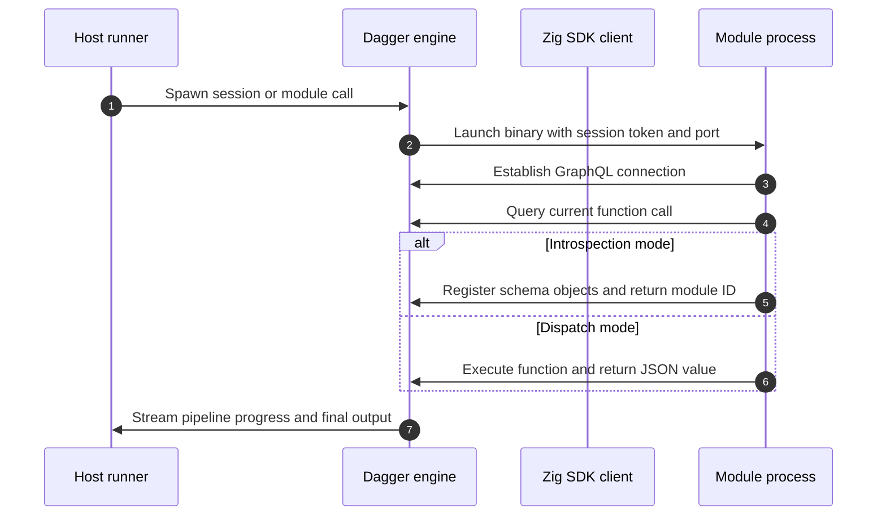
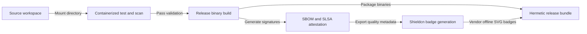
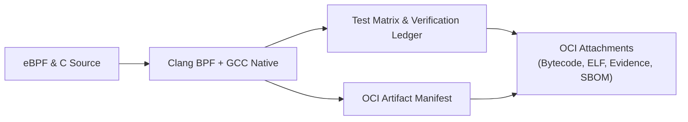

# Zero-to-hero guide and cookbook for dagger-zig

This guide walks through using the Dagger Zig SDK, from running a first container command to writing and publishing compile-time Dagger modules.

## Table of contents

1. [Stage 1: Setup and prerequisites](#stage-1-setup-and-prerequisites)
2. [Stage 2: Your first container pipeline](#stage-2-your-first-container-pipeline)
3. [Stage 3: Multi-stage pipelines and artifact extraction](#stage-3-multi-stage-pipelines-and-artifact-extraction)
4. [Stage 4: Caching compiler and package manager artifacts](#stage-4-caching-compiler-and-package-manager-artifacts)
5. [Stage 5: High-performance concurrency with groups and branches](#stage-5-high-performance-concurrency-with-groups-and-branches)
6. [Stage 6: Authoring compile-time Dagger modules](#stage-6-authoring-compile-time-dagger-modules)
7. [Stage 7: Production cookbook and real-world recipes](#stage-7-production-cookbook-and-real-world-recipes)
   - [Recipe 1: Cross-compiling Zig services with musl targets](#recipe-1-cross-compiling-zig-services-with-musl-targets)
   - [Recipe 2: Building and caching Go microservices](#recipe-2-building-and-caching-go-microservices)
   - [Recipe 3: Building and caching Rust applications](#recipe-3-building-and-caching-rust-applications)
   - [Recipe 4: Packaging and distributing eBPF programs as OCI artifacts with attachments](#recipe-4-packaging-and-distributing-ebpf-programs-as-oci-artifacts-with-attachments)
8. [Stage 8: Publishing modules and CI integration](#stage-8-publishing-modules-and-ci-integration)

## Stage 1: Setup and prerequisites

The Dagger Zig SDK requires:
- Zig 0.16.0 or Zig 0.17.0
- Dagger CLI v0.16.0 or newer on `PATH`

The SDK operates in two distinct modes:
1. Client mode: a standalone Zig binary that connects to the local Dagger engine session to orchestrate pipelines.
2. Module mode: an exported Dagger module that runs inside an engine container, exposing functions to the Dagger CLI and Daggerverse.

To add the SDK to an existing Zig project, edit `build.zig.zon`:

```zig
.{
    .name = .my_pipeline,
    .version = "0.1.0",
    .minimum_zig_version = "0.16.0",
    .dependencies = .{
        .dagger_sdk = .{
            .url = "https://github.com/MChorfa/dagger-zig/archive/refs/tags/v0.4.0.tar.gz",
            .hash = "dagger_sdk-0.3.5-LXrZ7GawGACw8A-ST4QbS4wFrBflzYwGM22R1ZcMSKVQ",
        },
    },
    .paths = .{
        "build.zig",
        "build.zig.zon",
        "src",
    },
}
```

In `build.zig`, expose the dependency to your executable:

```zig
const std = @import("std");

pub fn build(b: *std.Build) void {
    const target = b.standardTargetOptions(.{});
    const optimize = b.standardOptimizeOption(.{});

    const dagger_dep = b.dependency("dagger_sdk", .{
        .target = target,
        .optimize = optimize,
    });

    const exe = b.addExecutable(.{
        .name = "pipeline",
        .root_module = b.createModule(.{
            .root_source_file = b.path("src/main.zig"),
            .target = target,
            .optimize = optimize,
        }),
    });
    exe.root_module.addImport("dagger_sdk", dagger_dep.module("dagger_sdk"));
    b.installArtifact(exe);

    const run_cmd = b.addRunArtifact(exe);
    run_cmd.step.dependOn(b.getInstallStep());

    const run_step = b.step("run", "Run pipeline");
    run_step.dependOn(&run_cmd.step);
}
```

## Stage 2: Your first container pipeline

The execution lifecycle between host, Dagger engine, and module is illustrated below:



In Zig 0.16 and 0.17, the entry point receives `init: std.process.Init`. This struct provides access to the general-purpose allocator as `init.gpa` and standard I/O as `init.io`.

Create `src/main.zig`:

```zig
const std = @import("std");
const dagger = @import("dagger_sdk");

pub fn main(init: std.process.Init) !void {
    const gpa = init.gpa;
    const io = init.io;

    var client = try dagger.connect(gpa, io, .{});
    defer client.close();

    const ctr = try client.dag().container(.{});
    const ctr_image = try ctr.from("alpine:3.20");
    const ctr_exec = try ctr_image.withExec(
        &.{ "echo", "Hello from Dagger Zig" },
        null,
        null,
        null,
        null,
        null,
        null,
        null,
        null,
        null,
        null,
    );

    const out = try ctr_exec.stdout();
    defer gpa.free(out);

    var stdout_file = std.Io.File.stdout();
    defer stdout_file.close(io);
    try stdout_file.writeStreamingAll(io, out);
}
```

Execute the pipeline through the Dagger CLI:

```bash
dagger run -- zig build run
```

The Dagger CLI provisions the engine session, populates connection environment variables, and streams progress.

## Stage 3: Multi-stage pipelines and artifact extraction

Multi-stage pipelines isolate the build toolchain from the production runtime image. Heavy compilers stay in the build container, while only the resulting artifact travels to the minimal runtime image.

```zig
const std = @import("std");
const dagger = @import("dagger_sdk");

pub fn main(init: std.process.Init) !void {
    const gpa = init.gpa;
    const io = init.io;

    var client = try dagger.connect(gpa, io, .{});
    defer client.close();

    const dag = client.dag();

    const build_base = try dag.container(null);
    const build_env = try build_base.from("golang:1.24-alpine");
    const build_code = try build_env.withExec(
        &.{
            "sh",
            "-c",
            "mkdir -p /src && echo 'package main; import \"fmt\"; func main() { fmt.Println(\"Server operational\") }' > /src/main.go",
        },
        null,
        null,
        null,
        null,
        null,
        null,
        null,
        null,
        null,
        null,
    );
    const build_dir = try build_code.withWorkdir("/src", null);
    const build_done = try build_dir.withExec(
        &.{ "go", "build", "-ldflags=-s -w", "-o", "server", "main.go" },
        null,
        null,
        null,
        null,
        null,
        null,
        null,
        null,
        null,
        null,
    );

    const binary = try build_done.file("/src/server", null);
    var binary_id = try binary.id();
    defer binary_id.deinit(gpa);

    const runtime_base = try dag.container(null);
    const runtime_env = try runtime_base.from("alpine:3.20");
    const runtime_app = try runtime_env.withFile(
        "/usr/local/bin/server",
        binary_id.value,
        null,
        null,
        null,
    );
    const runtime_perm = try runtime_app.withExec(
        &.{ "chmod", "+x", "/usr/local/bin/server" },
        null,
        null,
        null,
        null,
        null,
        null,
        null,
        null,
        null,
        null,
    );

    const test_run = try runtime_perm.withExec(&.{"/usr/local/bin/server"}, .{});

    const output = try test_run.stdout();
    defer gpa.free(output);

    var stdout_file = std.Io.File.stdout();
    defer stdout_file.close(io);
    try stdout_file.writeStreamingAll(io, output);
}
```

Artifacts are transferred across containers by capturing their identifier through `file.id()` and mounting them into target containers with `withFile`.

## Stage 4: Caching compiler and package manager artifacts

Dagger provides persistent cache volumes that survive across pipeline executions. This prevents repetitive network downloads and compiler rebuilds.

```zig
const std = @import("std");
const dagger = @import("dagger_sdk");

pub fn main(init: std.process.Init) !void {
    const gpa = init.gpa;
    const io = init.io;

    var client = try dagger.connect(gpa, io, .{});
    defer client.close();

    const dag = client.dag();

    const zig_cache = try dag.cacheVolume("zig-global-cache-v1");
    var zig_cache_id = try zig_cache.id();
    defer zig_cache_id.deinit(gpa);

    const apk_cache = try dag.cacheVolume("alpine-apk-cache-v1");
    var apk_cache_id = try apk_cache.id();
    defer apk_cache_id.deinit(gpa);

    const base = try dag.container(null);
    const ctr = try base.from("alpine:3.20");

    const cached_apk = try ctr.withMountedCache(
        "/etc/apk/cache",
        apk_cache_id.value,
        null,
        null,
        null,
        null,
    );

    const with_zig = try cached_apk.withExec(
        &.{ "apk", "add", "--no-cache", "zig" },
        null,
        null,
        null,
        null,
        null,
        null,
        null,
        null,
        null,
        null,
    );

    const cached_zig = try with_zig.withMountedCache(
        "/root/.cache/zig",
        zig_cache_id.value,
        null,
        null,
        null,
        null,
    );

    const test_build = try cached_zig.withExec(
        &.{ "zig", "version" },
        null,
        null,
        null,
        null,
        null,
        null,
        null,
        null,
        null,
        null,
    );

    const version_str = try test_build.stdout();
    defer gpa.free(version_str);

    var stdout_file = std.Io.File.stdout();
    defer stdout_file.close(io);
    try stdout_file.writeStreamingAll(io, version_str);
}
```

Cache volume guidelines:
- Scope cache volume keys with version suffixes, such as `zig-cache-v1`, to allow controlled cache invalidation.
- Mount cache directories at standard package manager paths before invoking build tools.
- Never write credentials or sensitive keys into cache volumes.

## Stage 5: High-performance concurrency with groups and branches

The Dagger Zig client maintains internal per-query state, including error registers and query builder buffers. Sharing a single client pointer across concurrent threads causes data races.

To run concurrent pipelines safely:
1. Call `client.branch()` for each concurrent worker. Branches share the engine connection while keeping independent per-query buffers.
2. Coordinate execution with Zig 0.17 `std.Io.Group`.
3. Apply `defer group.cancel(io)` to stop outstanding tasks immediately if one worker fails.

```zig
const std = @import("std");
const dagger = @import("dagger_sdk");

const TargetImage = struct {
    tag: []const u8,
    command: []const u8,
};

const targets = [_]TargetImage{
    .{ .tag = "alpine:3.20", .command = "cat /etc/alpine-release" },
    .{ .tag = "debian:bookworm-slim", .command = "cat /etc/debian_version" },
    .{ .tag = "fedora:41", .command = "cat /etc/fedora-release" },
};

const WorkerResult = struct {
    tag: []const u8,
    output: []u8,
};

fn inspectImage(
    io: std.Io,
    client: *dagger.Client,
    target: TargetImage,
    slot: *WorkerResult,
) std.Io.Cancelable!void {
    _ = io;
    slot.tag = target.tag;

    const base = client.dag().container(.{}) catch return error.Canceled;
    const ctr = base.from(target.tag) catch return error.Canceled;
    const run = ctr.withExec(
        &.{ "sh", "-c", target.command },
        null,
        null,
        null,
        null,
        null,
        null,
        null,
        null,
        null,
        null,
    ) catch return error.Canceled;

    slot.output = run.stdout() catch return error.Canceled;
}

pub fn main(init: std.process.Init) !void {
    const gpa = init.gpa;
    const io = init.io;

    var client = try dagger.connect(gpa, io, .{});
    defer client.close();

    var branches: [targets.len]dagger.Client = undefined;
    var count: usize = 0;
    defer for (branches[0..count]) |*b| b.close();

    while (count < targets.len) : (count += 1) {
        branches[count] = try client.branch();
    }

    var results: [targets.len]WorkerResult = undefined;

    var group: std.Io.Group = .init;
    defer group.cancel(io);

    for (targets, 0..) |target, i| {
        group.async(io, inspectImage, .{ io, &branches[i], target, &results[i] });
    }

    try group.await(io);

    var stdout_file = std.Io.File.stdout();
    defer stdout_file.close(io);

    for (&results) |*res| {
        defer gpa.free(res.output);
        const line = try std.fmt.allocPrint(gpa, "{s}: {s}", .{ res.tag, res.output });
        defer gpa.free(line);
        try stdout_file.writeStreamingAll(io, line);
    }
}
```

## Stage 6: Authoring compile-time Dagger modules

Dagger modules package reusable pipeline functions into executable components. The Zig SDK uses compile-time reflection to inspect public methods on Zig structs and generate the corresponding GraphQL schema.

A module directory must contain a `dagger.json` configuration file:

```json
{
  "name": "builder",
  "engineVersion": "v0.21.7",
  "sdk": "github.com/MChorfa/dagger-zig/sdk@v0.4.0",
  "source": "."
}
```

Create `main.zig` for the module:

```zig
const std = @import("std");
const dagger = @import("dagger_sdk");

pub const BuildReport = struct {
    platform: []const u8,
    file_count: i64,
    passed: bool,
};

pub const Builder = struct {
    /// Compiles a source directory inside Alpine and returns the built container.
    pub fn build(
        self: *const Builder,
        ctx: *dagger.module.Context,
        src: dagger.Directory,
    ) !dagger.Container {
        _ = self;
        const dag = ctx.dag();
        const base = try dag.container(null);
        const alpine = try base.from("alpine:3.20");

        const src_id = (try src.id()).value;
        const mounted = try alpine.withMountedDirectory(
            "/workspace",
            src_id,
            null,
            null,
            null,
        );
        const working = try mounted.withWorkdir("/workspace", null);

        return working.withExec(
            &.{ "sh", "-c", "echo 'Build finished' > build.log" },
            null,
            null,
            null,
            null,
            null,
            null,
            null,
            null,
            null,
            null,
        );
    }

    /// Evaluates the source directory and returns structured build metadata.
    pub fn inspect(
        self: *const Builder,
        ctx: *dagger.module.Context,
        src: dagger.Directory,
    ) !BuildReport {
        _ = self;
        _ = src;
        _ = ctx;

        return BuildReport{
            .platform = "linux/amd64",
            .file_count = 42,
            .passed = true,
        };
    }
};

pub fn main(init: std.process.Init) !void {
    return dagger.module.serve(init, Builder{});
}
```

Method conventions for Dagger modules:
- The first parameter is `self: *const Self` or `self: *Self`.
- The second parameter is `ctx: *dagger.module.Context`.
- Subsequent parameters receive caller arguments, including handles such as `dagger.Directory` or `dagger.File`.
- Return values can be primitives, Dagger handles, custom structs, or error unions.
- The `dagger.module.serve` call enters the request processing loop driven by the Dagger engine.

Test the module with the Dagger CLI:

```bash
dagger call build --src=.
dagger call inspect --src=.
```

## Stage 7: Production cookbook and real-world recipes

### Recipe 1: Cross-compiling Zig services with musl targets

This recipe models the build flow used by `shieldcn-zig`. It cross-compiles a static musl binary for multiple architectures and copies the output to a clean Alpine runtime image.



```zig
const std = @import("std");
const dagger = @import("dagger_sdk");

pub const ShieldcnModule = struct {
    pub fn build(
        self: *const ShieldcnModule,
        ctx: *dagger.module.Context,
        src: dagger.Directory,
        target: []const u8,
    ) !dagger.Container {
        _ = self;
        const dag = ctx.dag();

        const zig_cache = try dag.cacheVolume("zig-pkg-cache");

        var ctr = try ctx.container();
        ctr = try ctr.from("alpine:3.20");
        ctr = try ctr.withExec(&.{ "apk", "add", "--no-cache", "zig", "git" }, .{});
        ctr = try ctr.withDirectory("/workspace", src, .{});
        ctr = try ctr.withMountedCache("/root/.cache/zig", zig_cache, .{});
        ctr = try ctr.withWorkdir("/workspace", .{});

        const target_flag = try std.fmt.allocPrint(ctx.allocator(), "-Dtarget={s}", .{target});

        ctr = try ctr.withExec(&.{ "zig", "build", "-Doptimize=ReleaseSafe", target_flag }, .{});

        const binary = try ctr.file("/workspace/zig-out/bin/server", .{});

        var runtime = try ctx.container();
        runtime = try runtime.from("alpine:3.20");
        runtime = try runtime.withExec(&.{ "apk", "add", "--no-cache", "ca-certificates" }, .{});
        runtime = try runtime.withFile("/usr/local/bin/server", binary, .{});
        return runtime.withEntrypoint(&.{"/usr/local/bin/server"}, .{});
    }
};

pub fn main(init: std.process.Init) !void {
    return dagger.module.serve(init, ShieldcnModule{});
}
```

Invoke cross-compilation from the terminal:

```bash
dagger call build --src=. --target=x86_64-linux-musl
dagger call build --src=. --target=aarch64-linux-musl
```

### Recipe 2: Building and caching Go microservices

This recipe compiles a Go application using Go module and build caches.

```zig
const std = @import("std");
const dagger = @import("dagger_sdk");

pub const GoModule = struct {
    pub fn build(
        self: *const GoModule,
        ctx: *dagger.module.Context,
        src: dagger.Directory,
    ) !dagger.File {
        _ = self;
        const dag = ctx.dag();

        const mod_cache = try dag.cacheVolume("gomod-cache");
        const build_cache = try dag.cacheVolume("gobuild-cache");

        var ctr = try ctx.container();
        ctr = try ctr.from("golang:1.24-alpine");
        ctr = try ctr.withDirectory("/app", src, .{});
        ctr = try ctr.withMountedCache("/go/pkg/mod", mod_cache, .{});
        ctr = try ctr.withMountedCache("/root/.cache/go-build", build_cache, .{});
        ctr = try ctr.withWorkdir("/app", .{});

        ctr = try ctr.withExec(&.{
            "go",
            "build",
            "-trimpath",
            "-ldflags=-s -w",
            "-o",
            "/dist/app",
            ".",
        }, .{});

        return ctr.file("/dist/app", .{});
    }
};

pub fn main(init: std.process.Init) !void {
    return dagger.module.serve(init, GoModule{});
}
```

Extract the compiled binary directly to host storage:

```bash
dagger call build --src=. export --path=./bin/app
```

### Recipe 3: Building and caching Rust applications

This recipe builds release binaries with Cargo, persisting both registry indexes and target directories across runs.

```zig
const std = @import("std");
const dagger = @import("dagger_sdk");

pub const RustModule = struct {
    pub fn release(
        self: *const RustModule,
        ctx: *dagger.module.Context,
        src: dagger.Directory,
        binary_name: []const u8,
    ) !dagger.File {
        _ = self;
        const dag = ctx.dag();

        const cargo_cache = try dag.cacheVolume("cargo-registry");
        const target_cache = try dag.cacheVolume("cargo-target");

        var ctr = try ctx.container();
        ctr = try ctr.from("rust:1.85-alpine");
        ctr = try ctr.withExec(&.{ "apk", "add", "--no-cache", "musl-dev" }, .{});
        ctr = try ctr.withDirectory("/app", src, .{});
        ctr = try ctr.withMountedCache("/usr/local/cargo/registry", cargo_cache, .{});
        ctr = try ctr.withMountedCache("/app/target", target_cache, .{});
        ctr = try ctr.withWorkdir("/app", .{});

        ctr = try ctr.withExec(&.{ "cargo", "build", "--release" }, .{});

        const bin_path = try std.fmt.allocPrint(ctx.allocator(), "/app/target/release/{s}", .{binary_name});
        return ctr.file(bin_path, .{});
    }
};

pub fn main(init: std.process.Init) !void {
    return dagger.module.serve(init, RustModule{});
}
```

Extract the release binary to host storage:

```bash
dagger call release --src=. --binary-name=my_service export --path=./bin/my_service
```

### Recipe 4: Packaging and distributing eBPF programs as OCI artifacts with attachments

This recipe demonstrates using `dagger-zig` to build an eBPF TC ingress program (such as `csumguard`), compile its native C loader and supervisor, and package everything as a compliant **OCI Artifact** with multi-layer attachments (compiled bytecode `.bpf.o`, native loader binaries, SHA256SUMS manifest, cryptographic evidence ledger, and SLSA provenance).



```zig
const std = @import("std");
const dagger = @import("dagger_sdk");

pub const EbpfArtifactModule = struct {
    /// Build eBPF bytecode, native loader, and package as an OCI artifact tarball with attachments.
    pub fn packageOciArtifact(
        self: *const EbpfArtifactModule,
        ctx: *dagger.module.Context,
        src: dagger.Directory,
        tag: []const u8,
    ) !dagger.File {
        _ = self;
        const dag = ctx.dag();

        // 1. Build environment with clang, llvm, libbpf, and openssl
        var builder = try ctx.container();
        builder = try builder.from("ubuntu:24.04");
        builder = try builder.withExec(&.{
            "apt-get", "update", "-y",
        }, .{});
        builder = try builder.withExec(&.{
            "apt-get", "install", "-y", "--no-install-recommends",
            "clang", "llvm", "libbpf-dev", "libelf-dev", "libssl-dev",
            "make", "gcc", "ca-certificates",
        }, .{});

        // 2. Mount source and compile
        builder = try builder.withMountedDirectory("/workspace", src, .{});
        builder = try builder.withWorkdir("/workspace", .{});
        builder = try builder.withExec(&.{ "make", "all", "test" }, .{});

        // 3. Assemble OCI Artifact directory with attachments
        const dist = try builder.directory("/workspace/dist", .{});

        // 4. Construct OCI Image Manifest with custom attachment layer media-types:
        //    - application/vnd.csumguard.ebpf.v1 (eBPF bytecode)
        //    - application/vnd.csumguard.loader.v1 (ELF loader)
        //    - application/vnd.csumguard.evidence.v1+json (verification ledger)
        //    - application/vnd.in-toto+json (SLSA provenance attestation)
        var packager = try ctx.container();
        packager = try packager.from("ghcr.io/oras-project/oras:v1.2.2");
        packager = try packager.withMountedDirectory("/dist", dist, .{});
        packager = try packager.withWorkdir("/dist", .{});

        const push_cmd = try std.fmt.allocPrint(ctx.allocator(),
            "oras push --artifact-type application/vnd.csumguard.ebpf.v1 {s} " ++
            "csumguard_tc.bpf.o:application/vnd.csumguard.ebpf.layer.v1+binary " ++
            "csumguard_loader:application/vnd.csumguard.binary.v1+elf " ++
            "csumguard_launch:application/vnd.csumguard.binary.v1+elf " ++
            "SHA256SUMS:text/plain " ++
            "evidence/verification.json:application/vnd.csumguard.evidence.v1+json",
            .{tag},
        );

        packager = try packager.withExec(&.{ "sh", "-c", push_cmd }, .{});

        // Export artifact bundle tarball
        return builder.file("/workspace/csumguard-oci-artifact.tar.gz", .{});
    }
};

pub fn main(init: std.process.Init) !void {
    return dagger.module.serve(init, EbpfArtifactModule{});
}
```

Execute from the terminal:

```bash
dagger call package-oci-artifact --src=. --tag="ghcr.io/mchorfa/csumguard:0.2.0" export --path=./csumguard-oci-artifact.tar.gz
```

## Stage 8: Publishing modules and CI integration

### Publishing to Daggerverse

To publish a Dagger module written in Zig:
1. Ensure `dagger.json` is committed at your repository root or subdirectory.
2. Push your code to a public Git repository.
3. Run `dagger publish` from the module directory:

```bash
dagger publish
```

The CLI outputs the canonical module reference on Daggerverse, such as `dagger.cloud/my-org/my-module@v1.0.0`.

### GitHub Actions workflow

To run the pipeline in GitHub Actions, install the Dagger CLI and execute the module command:

```yaml
name: CI Pipeline

on:
  push:
    branches: [main]
  pull_request:

jobs:
  test-and-build:
    runs-on: ubuntu-latest
    steps:
      - name: Checkout source
        uses: actions/checkout@v4

      - name: Install Dagger CLI
        uses: dagger/dagger-for-github@v7
        with:
          version: "latest"
          verb: call
          args: build --src=.
```

### GitLab CI pipeline

Add a stage to `.gitlab-ci.yml`:

```yaml
stages:
  - test

dagger-build:
  stage: test
  image: docker:27-dind
  variables:
    DOCKER_HOST: tcp://docker:2375
  services:
    - docker:27-dind
  before_script:
    - apk add --no-cache curl
    - curl -fsSL https://dl.dagger.io/dagger/install.sh | BIN_DIR=/usr/local/bin sh
  script:
    - dagger call build --src=.
```

The Dagger CLI handles container provisioning, caching, and execution identically across local development machines, GitHub Actions, and GitLab CI runners.
```

---

## Suggested edits for existing documentation files

### 1. `docs/getting-started.md`
Update the minimal snippet to use `pub fn main(init: std.process.Init) !void` matching Zig 0.16/0.17 and correct generated signatures (`container(null)`, `from(...)`, `withExec(..., null, ...)`), then link directly to `zero-to-hero.md` for the full progression:

```markdown
# Getting started

This is the shortest path to a working call.

## 1. Add the SDK

Add `dagger_sdk` to `build.zig.zon`:

```zig
.{
    .name = .my_pipeline,
    .version = "0.1.0",
    .dependencies = .{
        .dagger_sdk = .{
            .url = "https://github.com/MChorfa/dagger-zig/archive/refs/tags/v0.4.0.tar.gz",
            .hash = "dagger_sdk-0.3.5-LXrZ7GawGACw8A-ST4QbS4wFrBflzYwGM22R1ZcMSKVQ",
        },
    },
    .paths = .{ "build.zig", "build.zig.zon", "src" },
}
```

## 2. Connect a client

In Zig 0.16 and 0.17, the entry point receives `init: std.process.Init`:

```zig
const std = @import("std");
const dagger = @import("dagger_sdk");

pub fn main(init: std.process.Init) !void {
    const gpa = init.gpa;
    const io = init.io;

    var client = try dagger.connect(gpa, io, .{});
    defer client.close();

    const ctr = try client.dag().container(.{});
    const based = try ctr.from("alpine:latest");
    const exec = try based.withExec(
        &.{ "echo", "hello from zig" },
        null,
        null,
        null,
        null,
        null,
        null,
        null,
        null,
        null,
        null,
    );

    const out = try exec.stdout();
    defer gpa.free(out);

    var stdout_file = std.Io.File.stdout();
    defer stdout_file.close(io);
    try stdout_file.writeStreamingAll(io, out);
}
```

## 3. Run it

```bash
dagger run -- zig build run
```

## Requirements

- Zig 0.16.0 or Zig 0.17.0
- Dagger CLI on `PATH`

## Next steps

- [Zero to Hero](zero-to-hero.md) for the complete tutorial and cookbook
- [Examples](examples.md) for copyable pipeline patterns
- [Module Authoring](module-authoring.md) for turning Zig structs into Dagger modules
- [Async Patterns](async-patterns.md) for concurrent fan-out
```

### 2. `docs/examples.md`
Add a reference link at the top to `zero-to-hero.md` as the comprehensive cookbook, and align snippet signatures with `gen.zig`.

### 3. `docs/SUMMARY.md`
Insert `[Zero to Hero](zero-to-hero.md)` right under `## Start Here`:
```markdown
## Start Here

- [Overview](README.md)
- [Getting Started](getting-started.md)
- [Zero to Hero](zero-to-hero.md)
- [Examples](examples.md)
- [Build Guide](build.md)
- [IDE Setup](ide-setup.md)
